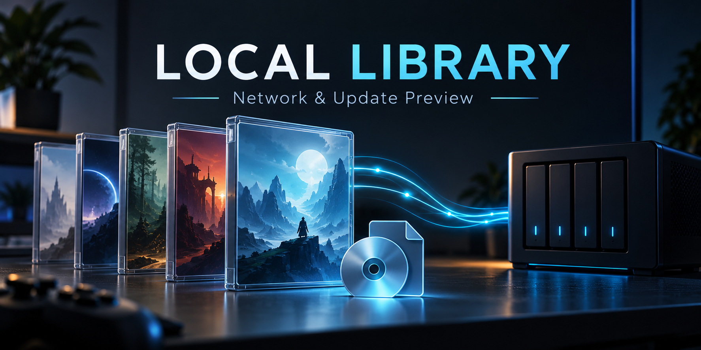

# Local Library – Netzwerk- und Update-Vorabversion

Ein Fork von [Azuravians Playnite-LocalLibrary](https://github.com/azuravian/playnite-LocalLibrary)
für Windows. Er verwaltet lokal erreichbare Installationsquellen, ordnet
Update-Dateien anhand numerischer Versionshinweise und kann eine vorhandene
Installation mit ihrer bestehenden Spielekarte verknüpfen.

## Installation

1. Playnite schließen und dessen Benutzerdaten sichern. Für einen ersten Test
   empfiehlt sich eine separate portable Playnite-Bibliothek mit Testeinträgen.
2. Unter [Releases](https://github.com/lesecuritae/playnite-LocalLibrary/releases)
   die `.pext` herunterladen. Das Quellcode-ZIP ist kein Installationspaket.
3. Playnite öffnen und die `.pext` ins Fenster ziehen. Installation bestätigen
   und Playnite anschließend neu starten.
4. Über **F9 > Erweiterungseinstellungen > Bibliotheken > Local Library**
   die Quelle einstellen. Die Erweiterung trägt den Zusatz „Network Preview“.
5. Bereits vorhandene LocalLibrary-Spielekarte mit rechts anklicken:
   **Local Library > Link existing installation...**. Installationsordner
   und Start-EXE auswählen. Cover, Spielzeit und Installationsquelle bleiben
   erhalten; das Spiel wird nicht erneut installiert oder verschoben.

Der Fork ersetzt die ursprüngliche LocalLibrary-Erweiterung und verwendet
absichtlich dieselbe Plugin-ID. Beide Varianten dürfen nicht gleichzeitig als
getrennte Erweiterungen installiert werden. Ein Update aus dem ursprünglichen
Add-on-Katalog kann den Fork ersetzen. Eine eigene Katalogregistrierung und
automatische Update-Verteilung sind noch nicht eingerichtet.

Fehlt die Spielekarte vollständig, bietet Playnite selbst bereits einen
Ordner-Scan sowie das manuelle Hinzufügen einer EXE oder Verknüpfung an.
Dieser Fork führt keine automatischen Zusammenführungen fremder Plugins durch.

## Was funktioniert, was ist noch offen?

- Update-Erkennung erhält vorhandene Aktionen, Argumente und Hauptinstaller.
- Numerische Sortierung behandelt beispielsweise 1.9 vor 1.10. Zeitstempel
  dienen nur als Ersatzkriterium; Dateinamen beweisen keine Kompatibilität.
- Mehrdeutige oder unvollständige automatische Installer-Auswahl wird abgelehnt.
- Normale Ordner, USB, SMB oder bereits eingehängte SSHFS-Ordner sind als
  Quellen vorgesehen. SSHFS ist optional; rclone wird nicht benötigt.
- Vollständiger Windows-Build und fünf Testsuiten mit **569 Prüfungen** bestanden.
  Dabei wurden keine echten Spiele oder Installer gestartet.
- Bedienung und Neustart in Playnite, echte Spielstarts und Netzwerk-ISOs
  müssen noch praktisch abgenommen werden.
- Unbeaufsichtigte Installer-Ketten sind noch nicht freigegeben. Die geerbte
  Batch-Ausführung benötigt eine Überarbeitung für Schrittstatus, Abbrüche
  und verlässlich zugeordnete ISO-Mounts.
- xREL-Abgleich, veraltete Updates ausblenden und neue Updates melden sind
  geplant, aber noch nicht implementiert. Update-Dateien werden nicht beschafft.

## Rückkehr zur Originalversion

Playnite schließen und die ursprüngliche LocalLibrary-`.pext` wieder
installieren. Falls Bibliothekseinträge zurückgesetzt werden sollen, die vorher
angelegte Datensicherung wiederherstellen. Ein Downgrade der Erweiterung macht
Datenbankänderungen nicht automatisch rückgängig. Spieldateien nicht löschen.

[Englische Anleitung](README.md) · [Tests](tests/README.md) ·
[Entwicklungsstand](DEVELOPMENT_STATUS.md) · [Arbeitsplan](WORKSHEET.md)
