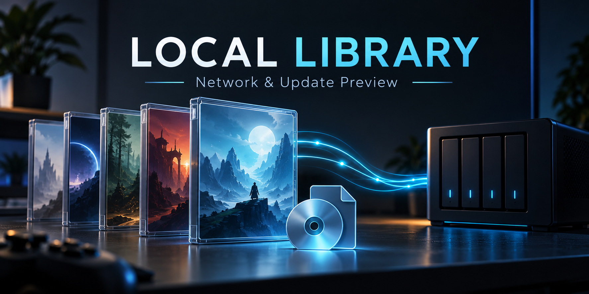

# Local Library: network/update preview



[Deutsche Anleitung](README.de.md)

A Windows Playnite LocalLibrary fork of
[azuravian/playnite-LocalLibrary](https://github.com/azuravian/playnite-LocalLibrary).
This preview adds deterministic numeric update ordering, bounded installer
source discovery, and linking games which are already installed. It is an
in-progress extension, not a complete installer/update manager.

## Install the preview

1. Install normal Windows Playnite. Close it and back up its user-data folder
   before replacing an existing LocalLibrary installation. For a first trial,
   use a separate portable Playnite library with disposable entries.
2. Download the `.pext` asset from this fork's
   [Releases](https://github.com/lesecuritae/playnite-LocalLibrary/releases)
   page. Do not use GitHub's source-code ZIP as the add-on installer.
3. Open Playnite and drag the `.pext` onto its window, confirm installation,
   then restart Playnite when prompted.
4. Open **Add-ons (F9) > Extension settings > Libraries > Local Library**
   and choose your library source. The settings label may display the preview
   name. See [the original setup guide](UPSTREAM_README.md) for source actions.
5. For an existing LocalLibrary game card, right-click and select
   **Local Library > Link existing installation...**. Choose that game's
   installed folder, then its launch `.exe`. The operation retains the card's
   cover, playtime and source installer; it does not reinstall or move files.

This is a replacement variant of LocalLibrary and deliberately retains the
original plugin ID to preserve ownership of existing cards/settings. Do not
install it as a second independent copy alongside the original. Upstream
catalog updates can replace it: check the displayed version before accepting
updates. This fork is not registered as a separate catalog add-on.

For a game without a source card, normal Playnite already offers **Add game >
Scan automatically**, manual entry, and drag-and-drop of a launch executable.
Automatic cross-plugin duplicate merging is not provided by this preview.

## Sources and current limits

Sources may be ordinary local/USB folders, reachable SMB paths, or folders
already exposed by SSHFS. SSHFS is optional and configured outside the plugin;
credentials are not stored by this extension. rclone is not required.
Remote access does not make an unavailable share available automatically.
Real SMB/SSHFS ISO operation has not passed acceptance yet.

Updates are ordered by numeric target-version hints, then filesystem timestamp
and path; filenames and timestamps are not proof of compatibility or release
dates. Existing custom actions and arguments are preserved. Ambiguous or
incomplete automatic installer selection is refused. No update payloads are
acquired, no DRM workarounds are implemented, and xREL integration remains open.

**Do not use unattended installer chains from this preview.** The inherited
batch workflow still needs replacement with per-step outcome tracking and
owned ISO mount handling. The supported new trial is discovery and explicit
linking of an already installed game. Interactive UI/library restart and real
game launch acceptance remain outstanding.

## Evidence and development

The complete plugin built on Windows for .NET Framework4.6.2 / MSIL. Five
Windows suites passed **569 assertions** using disposable text-file fixtures
and real Playnite SDK objects. This does not establish compatibility with 569
games or an interactive UI pass. See [tests/README.md](tests/README.md),
[DEVELOPMENT_STATUS.md](DEVELOPMENT_STATUS.md) and [WORKSHEET.md](WORKSHEET.md).

```powershell
./build.ps1
./tests/run-all-tests.ps1
./package.ps1 -ToolboxPath C:\Playnite\Toolbox.exe
```

Build prerequisites and isolated compiler/reference-pack options are described
in the test guide. Packaging uses Playnite's official Toolbox and an explicit
runtime-file allowlist; source, tests, credentials and Playnite.SDK are not
bundled. Releases here are explicitly marked as previews until the remaining
acceptance gates pass.

## Roll back

Close Playnite, reinstall the original LocalLibrary `.pext`, and reopen it.
Both variants share the same plugin identity. If a library change needs to be
undone, restore the user-data backup made before testing. Removing a source
or changing games is not required to install this preview. Never delete game
files as part of rollback. Do not assume an add-on downgrade undoes database
edits; retain the library backup.

Upstream code and attribution are retained under [CC0](LICENSE).
